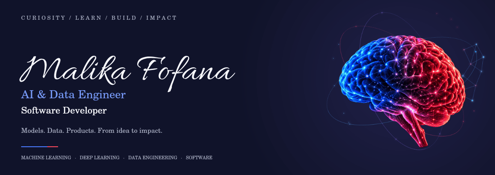

### AI & Data Engineer · Software Developer

**Machine Learning · IA générative & NLP · Data Engineering · Web & Mobile**

[Portfolio](https://malikafofana.github.io/portfolio/) · [LinkedIn](https://www.linkedin.com/in/malika-fofana/)

## De l’idée à une solution concrète

Je suis **Malika Fofana — AI & Data Engineer et Software Developer**. Je conçois et développe des solutions à la croisée de **l’intelligence artificielle, de l’ingénierie des données et du développement logiciel** : modèles de Machine Learning, applications intégrant des LLM, pipelines de données, APIs et produits web et mobiles.

Je suis en **Master 1 du Programme Grande École en IA & Data à aivancity**, où je suis major de promotion. Mes expériences couvrent les télécommunications, le juridique, la santé, l’immobilier et les outils métier.

Mon parcours s’est construit autour d’une conviction simple : **la technologie prend toute sa valeur lorsqu’elle répond à un véritable besoin**. Mes expériences relient intelligence artificielle, analyse de données, développement logiciel, automatisation, traitement du langage, OCR et blockchain.

J’aime intervenir à chaque étape d’un projet : **comprendre un besoin, explorer les données, concevoir une solution, la développer et la rendre réellement utile**. Cette polyvalence me permet de croiser différentes approches, de travailler sur des problématiques variées et de transformer des idées ambitieuses en produits concrets.

Je souhaite contribuer à **l’innovation en IA et en data**, avec un intérêt particulier pour **la recherche, la santé et les sciences du vivant**. À plus long terme, mon projet est de poursuivre un **doctorat à l’intersection de l’IA, de la data et de la santé**.

> **Recherche d’alternance en IA & Data — octobre 2026**  
> Paris / Île-de-France · 3 semaines en entreprise / 1 semaine à l’école  
> Également ouverte aux collaborations autour de projets IA, data et développement.

## Ma manière de travailler

| Curiosité | Rigueur | Créativité | Impact |
| --- | --- | --- | --- |
| Comprendre en profondeur avant de construire | Structurer les données et les problématiques complexes | Explorer différentes approches | Répondre à des besoins réels |

## Ce que je développe

| Domaine | Mon travail |
| --- | --- |
| **Machine Learning & Deep Learning** | Préparation des données, modèles de classification, CNN, transfert d’apprentissage et analyse des résultats |
| **IA générative & NLP** | Recherche documentaire, architectures RAG, intégration de LLM et pipelines associant reconnaissance vocale et traitement du langage |
| **Data Engineering & Analytics** | Collecte par API, automatisation, nettoyage, qualité des données, SQL et tableaux de bord métier |
| **Software Engineering** | Applications Next.js / React, services REST, interfaces TypeScript et workflows métier |
| **Web & Mobile** | Applications Next.js / React, intégration mobile avec Capacitor, services Firebase, fonctionnalités sociales et notifications |
| **OCR & Blockchain** | Extraction de documents et expériences de vérification de diplômes avec Hyperledger Fabric |

## Des expériences concrètes, dans plusieurs secteurs

| Expérience | Sujets sur lesquels j’ai travaillé |
| --- | --- |
| **Orange Côte d’Ivoire — B2B** | Analyse de l’activité et de l’inactivité des clients, dashboards et KPIs, scoring IA ; interfaces Next.js / TypeScript, filtres dynamiques, virtualisation des listes et import Excel avec SheetJS |
| **Craft AI — JurisIA** | Assistant juridique, architecture RAG avec récupération en direct via Légifrance / PISTE et traçabilité des sources |
| **Veltis** | Plateforme de données cliniques, collecte automatisée, intégration de sources, qualité des données et Power Pages |
| **Kaydan** | Vérification de diplômes avec Hyperledger Fabric, workflows de recrutement en Node.js / TypeScript / React et pipeline OCR de documents |
| **Kaufman & Broad** | Analyse de données territoriales et travaux autour d’un assistant interne NLP / LLM |
| **Groupe Image et Concept** | Pipeline associant reconnaissance vocale et modèles de langage |

<strong>D’autres expériences qui ont construit mon parcours</strong>

- **Puissance de Femmes** : collecte et scraping de données en Python.
- **Ba&sh** : analyse de retours clients avec Excel et Power BI.
- **Sursaut Technologie** : conception, développement et déploiement d’un site Next.js pour un think tank consacré à l’innovation technologique en Afrique.

Ces expériences m’ont permis de relier le développement technique aux besoins métier, dans des environnements et des secteurs différents.

## Mes projets techniques publics

| Projet | Ce qu’il permet d’explorer |
| --- | --- |
| [**Alzheimer MRI Study**](https://github.com/malikafofana/alzheimer-mri-study) | Travail académique réalisé avec **Klara Mladenovic** : CNN, ResNet50, Grad-CAM, DCGAN et analyse critique des résultats |
| [**Telco Signal**](https://github.com/malikafofana/telco-signal) | Prototype local : ingestion d’événements, qualité des données, entrepôt SQL, features temporelles, comparaison de modèles et API de scoring |
| [**Evidence Search**](https://github.com/malikafofana/evidence-search) | Prototype de recherche documentaire : BM25, TF-IDF, fusion de rangs, citations exactes et évaluation du retrieval |
| [**Agentic Data Lab**](https://github.com/malikafofana/projet_agentic) | Prototype MCP pour l’analyse de CSV avec SQLite, outils SQL et historique de session ; module auxiliaire encore manquant |
| [**Time Series Lab**](https://github.com/malikafofana/timeseriesentrainement1) | Exercices du cours de Jesus Lopez / LinkedIn Learning : prévision et validation temporelle |
| [**Docker Web Stack**](https://github.com/malikafofana/tp3-docker) | Travail pratique Nginx, PHP-FPM, MariaDB et orchestration Docker Compose |

Les README présentent le code, les instructions et le périmètre de chaque dépôt. Telco Signal utilise des données synthétiques ; Evidence Search, un corpus de démonstration. Le projet Alzheimer est une étude académique sans validation clinique. Mes projets professionnels sont décrits ici ; leur code reste dans son contexte d’origine.

<strong>Une réalisation web et mobile : HolyConnect</strong>

Je suis la fondatrice et Product Developer de [**HolyConnect**](https://holyconnect.app), une application sociale chrétienne. Ce projet fait partie de mes réalisations en développement logiciel et produit.

Mon travail couvre la conception, l’UX/UI, le développement full-stack, les tests utilisateurs et le déploiement. L’application associe fonctionnalités sociales, chatbot IA, recherche biblique et notifications.

**Stack :** Next.js · TypeScript · Capacitor · Firebase · Firebase Cloud Messaging

## Ma stack

| | Technologies et outils |
| --- | --- |
| **Langages** | Python · SQL · TypeScript · JavaScript · Bash |
| **IA & ML** | scikit-learn · TensorFlow / Keras · CNN · Transfer Learning · LLM · NLP · RAG · Speech-to-Text |
| **Données & BI** | Pandas · APIs · SQL · Qualité des données · Power BI · Excel · SheetJS |
| **Développement** | Next.js · React · Node.js · Tailwind CSS · REST APIs · Zustand |
| **Mobile & services** | Capacitor · Firebase · Firebase Cloud Messaging |
| **Infrastructure & outils** | Docker · Docker Compose · Git / GitHub · Linux · Hyperledger Fabric |

<strong>Ce qui m’intéresse pour la suite</strong>

- Construire des produits IA utiles, depuis la donnée jusqu’à l’application.
- Développer des pipelines et des plateformes de données pour des besoins concrets.
- Approfondir le Machine Learning, le Deep Learning et l’évaluation des systèmes d’IA.
- Participer à des projets de R&D, notamment en santé et en sciences du vivant.

<strong>Formation, curiosité scientifique et numérique responsable</strong>

- **IBM** : Generative AI in Action et Fundamentals of Sustainability.
- **Inria / FUN** : Impacts environnementaux du numérique.
- **ONU / UNITAR / PNUE** : REDD+.
- **NASA & AIA** : participation à une initiative de recherche d’astéroïdes par analyse de données astronomiques.

## Mon activité GitHub

Une animation de mes contributions réelles, actualisée quotidiennement.

**Comprendre l’esprit, révéler le potentiel, bâtir un avenir meilleur.**

[Découvrir mon portfolio](https://malikafofana.github.io/portfolio/) · [Échanger sur LinkedIn](https://www.linkedin.com/in/malika-fofana/)

